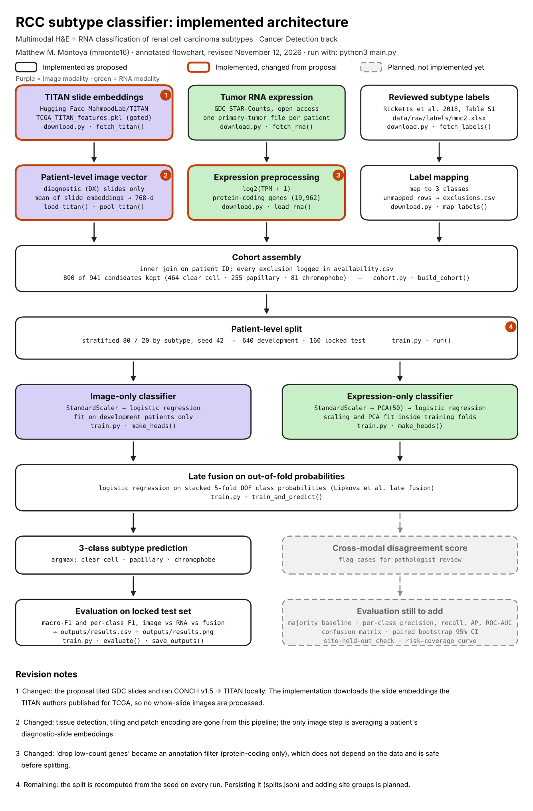

# Capstone AI Architecture — RCC Subtype Classifier

**Name / JHU ID:** Matthew M. Montoya / mmonto16  
**Project title / track:** Multimodal H&E + RNA classification of renal cell carcinoma subtypes / Cancer Detection

All results in this submission come from real TCGA data. No synthetic or demo data is used anywhere in the pipeline.

## Purpose and research foundation

**Question.** Does combining diagnostic H&E histopathology with tumor RNA expression improve patient-level classification of clear cell, papillary and chromophobe renal cell carcinoma (RCC) over either modality alone?

The three subtypes differ in both tissue morphology and molecular programs, and the Pan-kidney TCGA study by Ricketts et al.<sup>1</sup> provides pathology-reviewed subtype labels for the same patients. The design follows the late-fusion pattern described in the review by Lipkova et al.<sup>3</sup>: train one classifier per modality, then combine their predicted probabilities. The image side uses frozen slide embeddings from the TITAN pathology foundation model<sup>2</sup> instead of training an image model. Improvement from fusion is a hypothesis to test, not an assumed outcome. This is retrospective classification of established tumors; it is not screening and makes no clinical-readiness claim.

## Data

| Input | Source | Access |
| --- | --- | --- |
| Slide embeddings | [MahmoodLab/TITAN](https://huggingface.co/MahmoodLab/TITAN) on Hugging Face, file `TCGA_TITAN_features.pkl` (one 768-d vector per TCGA slide) | **Gated: request access (steps below)** |
| RNA expression | [GDC](https://portal.gdc.cancer.gov/) projects TCGA-KIRC, TCGA-KIRP, TCGA-KICH; STAR-Counts gene expression files, Data Release 46.0 | Open access; no account or request needed |
| Labels | Ricketts et al. 2018,<sup>1</sup> Table S1, column `PanKidney Pathology` | Included: `data/raw/labels/mmc2.xlsx` |

- **Observation unit:** one patient's primary renal tumor. A patient's diagnostic slides are averaged into one image vector, and one primary-tumor RNA file is selected per patient by a fixed rule.
- **Inputs (X):** 768-d mean TITAN embedding; log2(TPM + 1) for 19,962 protein-coding genes.
- **Reference labels (y):** reviewed histologic subtype mapped to three classes. GDC project codes are never used as labels or features.
- **Cohort:** 800 of 941 candidate patients have a label, an embedding and RNA: 464 clear cell, 255 papillary, 81 chromophobe. The 141 exclusions are all for a missing label, image or RNA file, and each is logged by the pipeline.
- **Limitations:** single retrospective cohort (TCGA) with no external test set; class imbalance (chromophobe is 10%); a patient match does not guarantee the slide and RNA came from the same tissue section; site and batch effects are not yet audited; the reference label itself comes from pathology review of the same slides.

### What is and is not in this ZIP

Included so the cohort can be rebuilt exactly: `data/manifests/` (the GDC file chosen for each patient, with md5 checksums, and the GDC release) and Table S1. Not included: the RNA files (3.8 GB), and the TITAN features and anything derived from them, because TITAN is licensed CC-BY-NC-ND 4.0 and may not be redistributed. `main.py` downloads both.

### Requesting TITAN access (one time)

The TCGA files from GDC need no request. Only the TITAN features are gated:

1. Create or sign in to a [Hugging Face](https://huggingface.co/join) account whose primary email is institutional (e.g. `@jhu.edu`). Requests from Gmail addresses are denied.
2. Open the [TITAN model page](https://huggingface.co/MahmoodLab/TITAN), fill in the access form and accept the terms. Wait for the approval email.
3. Create a read token at [huggingface.co/settings/tokens](https://huggingface.co/settings/tokens).
4. After installing the requirements (next section), run `hf auth login` and paste the token.

## Flowchart to code



`download → cohort → split → train → predict → evaluate`

| Flowchart node | File · function | Receives → returns |
| --- | --- | --- |
| Download inputs | `rcc/data/download.py` · `fetch_titan()`, `fetch_rna()`, `fetch_labels()` | manifest of GDC file IDs → files under `data/raw/` |
| Load and preprocess | `rcc/data/download.py` · `load_titan()`, `pool_titan()`, `load_rna()`, `map_labels()` | raw files → per-patient image matrix, log2 TPM matrix, label table |
| Cohort assembly | `rcc/data/cohort.py` · `build_cohort()` | the three tables → aligned `cohort.parquet`, `X_img.npy`, `X_rna.npy` in `data/processed/` |
| Patient-level split | `rcc/train.py` · `run()` | labels → stratified 80/20 train and test indices (seed 42) |
| Train and predict | `rcc/train.py` · `make_heads()`, `train_and_predict()` | training features and labels, test features only → test predictions for image, RNA and fusion |
| Evaluate and save | `rcc/train.py` · `evaluate()`, `save_outputs()` | predictions and test labels → `outputs/results.csv`, `outputs/results.png` |
| Settings | `rcc/config.py` | seed, paths, class map |

`main.py` connects these stages. Scaling and PCA sit inside scikit-learn pipelines, so they are fit on training folds only; the fusion model is trained on out-of-fold probabilities and sees the test set once.

## Setup and run

Python **3.14** (the pinned versions in `requirements.txt` are the ones that produced the saved results).

```bash
python3 -m pip install -r requirements.txt
hf auth login        # once, after TITAN access is approved
python3 main.py
```

`main.py` runs everything from input to output:

1. Downloads the TITAN features (37 MB) and the 889 RNA files listed in `data/manifests/rna_selected.csv` (3.8 GB) into `data/raw/`. Downloads are checksum-verified and resumable: if interrupted, run `python3 main.py` again.
2. Builds the cohort in `data/processed/`.
3. Splits, trains the image, RNA and fusion classifiers, evaluates on the held-out patients, and saves the table and the graph.

On later runs steps 1 and 2 are skipped and only step 3 runs (under a minute).

## How Primary Research, Challenging Evidence, and Capstone Guidance Informed the Implementation

| Source | Finding or suggestion | Decision and reason | File · function | How I will check it |
| --- | --- | --- | --- | --- |
| Ricketts et al.<sup>1</sup> (primary) | Pathology review reassigned some tumors, so TCGA project membership is not a reliable subtype label. | **Adopted.** Labels come from Table S1, not project codes. | `download.py` · `map_labels()`, `classify_subtype()` | Label counts are compared with the published 488 / 274 / 81 and a warning is printed on mismatch; unmapped rows go to `exclusions.csv`. |
| Ding T et al.<sup>2</sup> (TITAN) | Frozen slide-level foundation embeddings support linear classifiers without fine-tuning; TITAN was not pretrained on TCGA. | **Modified.** The proposal ran tiling → CONCH v1.5 → TITAN locally. I use the authors' published TCGA embeddings instead: same representation, no whole-slide processing. | `download.py` · `fetch_titan()`, `pool_titan()` | Image-only macro-F1 on held-out patients; file sha256 recorded in `provenance.json`. |
| Lipkova et al.<sup>3</sup> (review) | Late fusion combines per-modality predictions and suits small cohorts with heterogeneous inputs. | **Adopted.** Logistic regression on stacked out-of-fold probabilities. | `train.py` · `train_and_predict()` | Fusion vs. best single modality on the same test patients; paired bootstrap interval still to add. |
| Ding S et al.<sup>4</sup> (challenging evidence) | Dense co-attention between image and omics features outperforms simple fusion for subtype classification. | **Rejected for now.** With 800 patients and one vector per slide, I start with the simplest fusion and add complexity only if it fails to beat the single-modality baselines. | `train.py` · `train_and_predict()` | If fusion shows no gain with a confidence interval, test an intermediate-fusion model on the same split. |
| Moradinasab et al.<sup>5</sup> (challenging evidence) | Multimodal models that assume complete data are unreliable when a modality is missing. | **Rejected for now, documented.** The cohort keeps only patients with both modalities; 141 excluded patients are logged for comparison. | `cohort.py` · `build_cohort()` → `availability.csv` | Compare included and excluded patients by subtype and site. |
| Capstone guidance | Split by patient; fit learned preprocessing on training data only; pass test inputs without labels. | **Adopted.** | `train.py` · `run()`, `make_heads()` | One row per patient by construction; scaler and PCA are inside the pipelines. |
| Capstone guidance | Show a plot and supporting evaluation before claiming a result. | **Adopted, partly.** One table and one graph per run; the planned secondary metrics are not implemented yet. | `train.py` · `evaluate()`, `save_outputs()` | See remaining work. |

Madrigal et al.<sup>6</sup> describes gene-expression programs that distinguish RCC subtypes; it motivates the planned pathway-level RNA features and is not yet reflected in code.

## Outputs and evaluation

One execution of `python3 main.py` saves exactly one table and one graph, both from the same held-out predictions:

| File | Contents |
| --- | --- |
| `outputs/results.csv` | Macro-F1 and per-class F1 on the 160 held-out patients for the image, RNA and fusion models |
| `outputs/results.png` | Grouped bar chart of the same table |

Everything else the pipeline writes (downloads in `data/raw/`, arrays and audit tables in `data/processed/`) is intermediate and not submitted.

The copies in this ZIP are from the run on my machine (macOS arm64, Python 3.14):

| model | macro-F1 | clear cell | papillary | chromophobe |
| --- | --- | --- | --- | --- |
| image | 0.944 | 0.962 | 0.961 | 0.909 |
| rna | 0.919 | 0.931 | 0.891 | 0.933 |
| fusion | 0.945 | 0.957 | 0.941 | 0.938 |

- **Metric:** macro-F1 (primary) weights the three subtypes equally, so the small chromophobe class is not hidden by the majority class.
- **Reference evidence:** reviewed labels from Ricketts et al., withheld from model inputs.
- **Comparators:** the image-only and RNA-only models, evaluated on the same patients as fusion.
- **Uncertainty and limitations:** this is one 80/20 split with 160 test patients (16 chromophobe) and no confidence intervals. The fusion-vs-image difference of 0.001 macro-F1 is far inside the noise, so these numbers do **not** show that fusion helps. Repeat runs on one machine give identical files, but a re-run of the image model on Linux (Python 3.13, scikit-learn 1.9.1) gave macro-F1 0.934 instead of 0.944: one or two borderline test patients change class with the platform's numerics. Expect differences of about ±0.01 when reproducing.

## Architecture revisions and remaining work

**Flowchart changes since the proposal** (marked in orange on `flowchart.png`):

1. Tissue detection, tiling, CONCH v1.5 and the TITAN slide encoder were replaced by the TCGA slide embeddings published by the TITAN authors, averaged per patient.
2. "Drop low-count genes" became a protein-coding annotation filter, which does not depend on the data and is safe to apply before splitting.

**Implemented:** download with manifests and checksums, cohort assembly with exclusion log and provenance, patient-level stratified split, image and RNA classifiers, late fusion on out-of-fold probabilities, macro-F1 and per-class F1, one table and one graph.

**Unfinished branches** (dashed on the flowchart):

- Cross-modal disagreement score to flag cases for pathologist review.
- Majority-class baseline; per-class precision, recall, average precision and ROC-AUC; confusion matrices.
- Paired patient-bootstrap 95% confidence interval for fusion vs. the best single modality.
- Persisted split file and a site-held-out sensitivity analysis.
- Clinical variables (age, sex) and pathway-level RNA features.

`docs/make_flowchart.py` in the repository regenerates the flowchart as branches are completed.

## Three principles

- Write the least code that works.
- Reproduce bugs with a failing test, then verify the fix.
- Show a relevant plot and supporting evaluation before claiming a result.

## References

1. Ricketts CJ, De Cubas AA, Fan H, et al. The Cancer Genome Atlas comprehensive molecular characterization of renal cell carcinoma. *Cell Rep*. 2018;23(1):313-326.e5. doi:[10.1016/j.celrep.2018.03.075](https://doi.org/10.1016/j.celrep.2018.03.075)
2. Ding T, Wagner SJ, Song AH, et al. A multimodal whole-slide foundation model for pathology. *Nat Med*. Published online 2025. doi:[10.1038/s41591-025-03982-3](https://doi.org/10.1038/s41591-025-03982-3)
3. Lipkova J, Chen RJ, Chen B, et al. Artificial intelligence for multimodal data integration in oncology. *Cancer Cell*. 2022;40(10):1095-1110. doi:[10.1016/j.ccell.2022.09.012](https://doi.org/10.1016/j.ccell.2022.09.012)
4. Ding S, Li J, Wang J, Ying S, Shi J. Multimodal co-attention fusion network with online data augmentation for cancer subtype classification. *IEEE Trans Med Imaging*. 2024;43(11):3977-3989. doi:[10.1109/TMI.2024.3405535](https://doi.org/10.1109/TMI.2024.3405535)
5. Moradinasab N, Sengupta S, Liu J, Syed S, Brown DE. Towards robust multimodal representation: a unified approach with adaptive experts and alignment. *arXiv*. Preprint posted online March 12, 2025. doi:[10.48550/arXiv.2503.09498](https://doi.org/10.48550/arXiv.2503.09498)
6. Madrigal A, Kim M, Mehrjoo Z, et al. Single-cell gene programs define subtype identity and metastatic trajectories in renal cell carcinoma. *medRxiv*. Preprint posted online July 16, 2026. doi:[10.64898/2026.07.14.26357682](https://doi.org/10.64898/2026.07.14.26357682)
7. National Cancer Institute. Genomic Data Commons Data Portal. Data Release 46.0. Accessed November 12, 2026. https://portal.gdc.cancer.gov/
